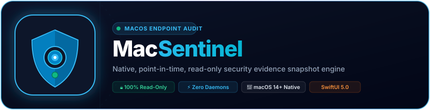

<p align="center">
  <a href="https://www.fullstopsolution.in">
    
  </a>
</p>

<p align="center">
  
</p>

<p align="center">
  <a href="https://www.fullstopsolution.in/macsentinel.html"></a>
  <a href="https://www.fullstopsolution.in/downloads/mac/MacSentinel-arm64.dmg"></a>
  <a href="https://github.com/iamkuruphere-sudo/MacSentinel/releases/latest"></a>
  <a href="https://www.fullstopsolution.in/security.html"></a>
</p>

# MacSentinel

Part of the **[Fullstop Solution](https://www.fullstopsolution.in)** precision software ecosystem.

A native SwiftUI macOS app for collecting a point-in-time, read-only security evidence snapshot. It does not remove files, change settings, install agents, quarantine software, or claim a clean bill of health.

---

## ⬇️ Official Downloads & Web Portal

| Resource | Link |
|---|---|
| 🌐 **Official Portal** | [www.fullstopsolution.in/macsentinel.html](https://www.fullstopsolution.in/macsentinel.html) |
| 🍏 **Direct DMG Download** | [MacSentinel-arm64.dmg](https://www.fullstopsolution.in/downloads/mac/MacSentinel-arm64.dmg) (v0.1.8 • 1.82 MiB) |
| 🛡️ **SHA-256 Checksum** | `0e878f246f53a1cf73e21ffe6fbd40496650e68ee501b8062174e64ffbdec681` |
| 📦 **GitHub Releases** | [MacSentinel Releases](https://github.com/iamkuruphere-sudo/MacSentinel/releases) |
| 🪟 **Cross-Platform Suite** | [Fullstop Desktop Suite](https://www.fullstopsolution.in/#desktop) |

---

## Checks included

- System Integrity Protection, Gatekeeper, FileVault, enrollment, and hardware/secure-boot related system profile data.
- TCP listeners and current TCP socket table, proxy settings, firewall state, and configured shares.
- Background-task inventory, system and user launch services, system extensions, and configuration profiles.
- Common launch-agent and launch-daemon folders plus Microsoft Office startup folders, where macro or add-in autoloading may occur.
- Installer history and selected recent macOS Unified Log events related to persistence, privacy permissions, update activity, and code-signing.

Items are evidence to inspect, not verdicts. Legitimate software commonly uses launch services, network connections, profiles, privacy permissions, and update helpers. The scanner gathers inventories and raw logs; it does not perform publisher reputation checks, malware signature matching, or compare the operating system against a known-good baseline.

## Logging

The app uses CocoaLumberjack to write its own audit lifecycle events to Unified Logging and a rotating local log file (daily rotation, up to seven files). It also reads selected existing events through Apple's `log show` command. Audit outputs can contain private paths and machine details; JSON export is explicit and saved only to the location the user chooses.

## Build and run

Requires macOS 14 or later. Building from source requires Swift 6.2 or later.

Download `MacSentinel-arm64.dmg` from the [Fullstop Solution Portal](https://www.fullstopsolution.in/downloads/mac/MacSentinel-arm64.dmg) or the [latest GitHub release](https://github.com/iamkuruphere-sudo/MacSentinel/releases/latest), open the disk image, and drag `MacSentinel.app` to Applications.

### macOS Gatekeeper Note
Because this open-source build is distributed without a paid Apple Developer subscription, macOS Gatekeeper may protectively show a warning on first launch (*"Apple could not verify MacSentinel..."*). To open:
```bash
xattr -cr /Applications/MacSentinel.app
```
*(Alternatively, right-click `MacSentinel.app` in Finder, hold **Control**, and select **Open**).*

To rebuild locally, open this folder in Xcode as a Swift package or run `swift run` from this directory. The first build resolves CocoaLumberjack from its official Swift Package Manager source.

## Boundaries and limitations

- macOS privacy protections can hide databases and log details unless the app has Full Disk Access or administrator privileges. The report should be read as partial when a command is denied or returns incomplete data.
- User-space checks cannot conclusively validate firmware, detect every spyware implant, or prove there was no unauthorized access. Apple silicon Secure Boot state is not fully exposed by a generic user-space command; hardware-specific verification may require Apple recovery or support tools.
- The Office scan finds files in conventional startup locations. It does not inspect every document for macros and does not infer that an Office macro is malicious.
- Run the app from a trusted source. This source project is not signed, notarized, or distributed as a hardened runtime application.
- Review evidence with a trusted security professional before deleting or disabling anything.

---

###  About Fullstop Solution

**Fullstop Solution** ([www.fullstopsolution.in](https://www.fullstopsolution.in)) develops precision open-source software, native enterprise security auditing tools, and privacy-first digital engineering suites. Built for developers, security researchers, and system administrators who require absolute privacy, client-side execution, and zero cloud lock-in.

- 🌐 **Official Website**: [https://www.fullstopsolution.in](https://www.fullstopsolution.in)
- 🍏 **MacSentinel Portal**: [https://www.fullstopsolution.in/macsentinel.html](https://www.fullstopsolution.in/macsentinel.html)
- ⬇️ **All Downloads & Desktop Tools**: [https://www.fullstopsolution.in/#desktop](https://www.fullstopsolution.in/#desktop)
- 📂 **GitHub Organization**: [https://github.com/iamkuruphere-sudo](https://github.com/iamkuruphere-sudo)
- 🔒 **Zero Telemetry Guarantee**: 100% client-side execution, zero external network leakage.

© 2026 Fullstop Solution (www.fullstopsolution.in). All rights reserved.
